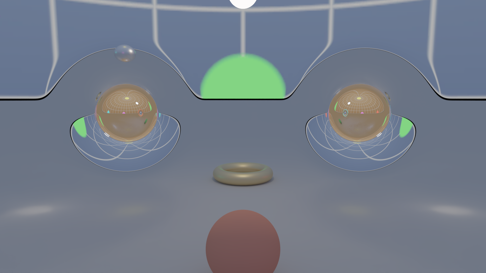

# 4D-гиперповерхности и геодезические: рендерер червоточин

[](LICENSE)


-76B900?logo=nvidia&logoColor=white)


Как выглядел бы мир, если бы само пространство было искривлено — с червоточиной, ведущей в другую вселенную, или
замкнуто в трёхмерную сферу, где, глядя вперёд, видишь собственный затылок? Этот проект рисует такие миры
физически честно: свет идёт по кратчайшим линиям (геодезическим) искривлённого пространства, а картинка
получается трассировкой путей — как в современных офлайн-рендерерах, но на GPU и в реальном времени.



*Две червоточины на «полу» нашего пространства. В горловинах видно другое пространство (второй лист) с его
небом и сеткой; шары за горловинами отражают то, что лежит по ту сторону. Кадр 1080p, 64 сэмпла на пиксель
и денойзер — 0.39 с на RTX 4080 SUPER.*

Полное задание — [TASK.md](TASK.md), текущий статус — [docs/PROGRESS.md](docs/PROGRESS.md).

---

## Производительность в двух словах

Все цифры — RTX 4080 SUPER, float32, медиана прогонов; каждая ведёт к каталогу с сырыми данными и командой запуска.

| Что | Время | Источник |
|---|---|---|
| Интерактивное окно, две червоточины, 1080p, камера движется (1 spp + денойзер) | **36 мс** (≈ 28 к/с) | [stage-5](results/stage-5/2026-10-24_app_bench_two_wormholes_1920x1080) |
| То же, 720p | **16 мс** (≈ 60 к/с) | [stage-5](results/stage-5/2026-10-24_app_bench_two_wormholes_1280x720) |
| Камера стоит: +1 сэмпл к накоплению, 1080p | **14 мс** | там же |
| Замкнутое пространство S³ (трёхмерная сфера), 720p | **16 мс** | [stage-5](results/stage-5/2026-10-24_app_bench_S3_1280x720) |
| Финальный кадр 1080p, 64 spp + денойзер | **0.39 с** | [stage-4](results/stage-4/2026-10-24_gpu_pt_profile) |
| Ролик 10 с, 1080p, 64 spp на кадр | **0.92 с/кадр**, 4.6 мин | [stage-5](results/stage-5/2026-10-24_video) |
| Фон с антиалиасингом и глубиной резкости без шума (режим A), 1080p | **31–40 мс** | [stage-3](results/stage-3/2026-10-24_gpu_profile) |

Типичный луч обходится в 100–200 вычислений геометрии. Точность при этом контролируется: направление
вылета луча отклоняется от эталона (DOP853 в float64) меньше чем на 0.05 углового размера пикселя
(p99, [ADR-0004](docs/adr/ADR-0004-float32-kappa.md)).

---

## Математика

### Пространство как поверхность в R⁴

Искривлённое трёхмерное пространство проще всего задать так же, как в школе задают кривую поверхность в
обычном пространстве, — уравнением, только на одно измерение выше:

    M = { x ∈ R⁴ : f(x) = 0 }.

Обычная сфера — это `x² + y² + z² − R² = 0` в R³; трёхмерная сфера S³ — `|x| − R = 0` в R⁴. Червоточина
Эллиса — `ρ − b·cosh(w/b) = 0`, где ρ = |(x, y, z)|: при больших |w| это два почти плоских «листа» (две
вселенные), соединённые горловиной радиуса b. Живущий на M наблюдатель четвёртой координаты не видит — для него
M и есть всё пространство, просто искривлённое.

Кроме червоточины Эллиса в проекте есть **червоточина с компактной кривизной** ([M11](docs/math.md)): снаружи
шара радиуса ρ₀ пространство в точности плоское, а гладкая, но «быстро гаснущая» функция типа exp(−1/x)
склеивает листы внутри. Это удобно: вдали от червоточин свет летит по прямой, и считать там нечего. Есть и
набор тестовых пространств с известными ответами — S³, S²×R, S¹×R², эллипсоид, торы.

Функцию f мы называем SDF (как в рендеринге неявных поверхностей), хотя расстоянием она быть не обязана: |∇f| = 1
нигде не предполагается.

### Как идёт свет: уравнение геодезической

Свет движется по геодезическим — «самым прямым» линиям на M. Для кривой на поверхности это значит: ускорение
направлено строго по нормали к поверхности (по касательной кривая не «поворачивает»). Нормаль — это ∇f, так что

    ẍ = λ ∇f,   |ẋ| = 1.

Множитель λ находится из условия «остаться на поверхности». Дважды продифференцируем f(x(s)) = 0 вдоль луча
(v = ẋ, H — гессиан f):

    d/ds  f = ∇f·v = 0,
    d²/ds² f = vᵀHv + ∇f·ẍ = 0   ⇒   λ = −vᵀHv / |∇f|².

Получилось обыкновенное дифференциальное уравнение на 8 переменных (x, v) ∈ R⁸, без всяких символов Кристоффеля
и карт координат — всё в «объемлющих» координатах R⁴. Есть одна тонкость: численное решение понемногу сползает с
поверхности. Поэтому в уравнение добавлено **стабилизирующее слагаемое Баумгарта** — мы требуем, чтобы отклонение
C = f(x) затухало как критически задемпфированный осциллятор, C̈ + 2αĊ + α²C = 0:

    ẍ = −(vᵀHv + 2α ∇f·v + α² f) · ∇f / |∇f|²                      (M2)

а после каждого принятого шага точка возвращается на M одним шагом Ньютона, скорость проецируется на
касательную плоскость и нормируется ([M3](docs/math.md)). Величина α подобрана измерением: α = 0.1/ℓ_s, где
ℓ_s — характерный размер сцены ([ADR-0001](docs/adr/ADR-0001-baumgarte-alpha.md)).

### Касательная плоскость и проектор

В каждой точке x ∈ M есть единичная нормаль n = ∇f/|∇f|. Все векторы, перпендикулярные ей, образуют
**касательное пространство** T_xM = { u ∈ R⁴ : n·u = 0 } — трёхмерное подпространство R⁴. Это те направления, в
которых житель M может двигаться и смотреть; скорость луча v всегда лежит в нём.

Любой вектор u ∈ R⁴ раскладывается на нормальную часть (n·u)·n и касательную часть — остаток. Отбрасывание
нормальной части — это ортогональная проекция на T_xM, и её удобно записать матрицей 4×4:

    P = I − n nᵀ,        P u = u − (n·u)·n.

Наглядно: это «тень» вектора на плоскость при свете, падающем вдоль нормали. Свойства прямо следуют из формулы
(с учётом |n| = 1):

- P² = P — повторная проекция ничего не меняет; Pᵀ = P — проекция ортогональная;
- P n = 0, а P u = u для любого касательного u: собственные числа 1, 1, 1 (касательные направления) и 0 (нормаль);
- |P u| ≤ |u|, причём (P u)·w = u·w для любого касательного w — проекция сохраняет всё, что «видно» изнутри M.

Пример: на сфере S³ в точке x = (0, 0, 0, R) нормаль n = (0, 0, 0, 1), и P просто обнуляет последнюю
координату: P·(a, b, c, d) = (a, b, c, 0).

В проекте проектор работает в трёх местах:

1. **Коррекция после шага** (M3). Численный шаг немного выводит v из касательного пространства; v ← Pv,
   затем нормировка, возвращает её обратно. То же делается с полями Якоби: J ← PJ, J′ ← PJ′.
2. **Оценка ошибки** интегратора берётся от P·e, а не от e: нормальную часть ошибки исправит пункт 1.
3. **Оператор формы** S = P·H·P/|∇f| — кривизна самой поверхности M. Гессиан H описывает, как меняется f по
   всем четырём направлениям R⁴, в том числе по нормали, а эта часть зависит лишь от того, *какой* функцией
   задана поверхность, а не от её формы. Например, f и φ(f) задают одно и то же M, но гессиан второй функции —
   φ′H + φ″·∇f∇fᵀ. Добавка φ″·∇f∇fᵀ направлена по нормали, и P её убирает, а множитель φ′ сокращается с |∇f|.
   Поэтому S зависит только от геометрии M. Для сферы |p| − R получается S = P/R: по всем касательным
   направлениям поверхность искривлена одинаково, с радиусом R. Геометрический смысл S: при сдвиге вдоль
   касательного u нормаль поворачивается со скоростью S·u.

### Почему jet-числа

На каждом шаге интегратора нужны три вещи: f, градиент ∇f и **вторая производная вдоль направления** vᵀHv.
Варианты:

- **Конечные разности** — для градиента и второй производной нужно около 9 вычислений f, а вычитание близких
  чисел съедает значащие цифры: у второй разности ошибка в лучшем случае ~√ε машинной точности. Во float32
  на GPU это ~10⁻⁴ — заметно грубее, чем нужно для точности в доли пикселя.
- **Автодифференцирование «как в ML»** (обратный режим) отлично работает в JAX, но в шейдере его нет, а полный
  гессиан 4×4 — это 10 чисел, из которых нужна одна комбинация.
- **Jet-числа** — арифметика усечённых многочленов Тейлора. Вместо вещественного числа программа работает с
  «числом» вида

      J = a + b·t + c·t² + Σᵢ dᵢ·sᵢ,      t³ = 0,  t·sᵢ = 0,  sᵢ·sⱼ = 0.

  Подставим в f точку x + t·v + s — и по правилам этой алгебры (сложение покомпонентно, умножение как у
  многочленов с отбрасыванием старших членов, для eᵘ, √u, 1/u — их ряд Тейлора до второго порядка) за **один
  проход** функции f получим сразу: a = f, b = ∇f·v, 2c = vᵀHv, d = ∇f. Это всё, что нужно для M2, и
  результат точен до округления — никаких шагов разности.

Проход на таких 7-компонентных числах (Jet7) стоит всего в 1.1–1.8 раза дороже вычисления самой f, а
вычисление с полным гессианом (Jet15, нужен для полей Якоби, см. ниже) — в 18–28 раз
([stage-2](docs/reports/stage-2.md)). Главное удобство: **SDF пишется один раз** обычным кодом, а тип чисел
подставляется — массивы JAX для эталона, Jet7, Jet15, дуальные числа. На GPU то же самое сделано через
интерфейс `IReal` в Slang.

У jet-подхода есть следствие для геометрии: **жёсткие min/max/abs запрещены**. Гессиан входит в правую часть
уравнения, и излом в f (например, у `min` при объединении фигур) превращается в разрыв ускорения — лучи
«ломаются». Поэтому используются гладкий минимум (log-sum-exp, все производные непрерывны) и «защищённая»
длина вектора ([M6](docs/math.md)).

### Как численно решать уравнение

Интегратор — **Богацкий–Шампин 3(2)** с адаптивным шагом и свойством FSAL (последняя стадия шага служит
первой стадией следующего, так что шаг стоит 3 прохода SDF, а не 4). Встроенная оценка ошибки берётся только
по **касательным** компонентам: нормальную ошибку всё равно исправит проекция, и тратить на неё шаги незачем.
Допуск привязан к угловому размеру пикселя: tol = κ·θ_pix, κ = 3·10⁻³ — точнее, чем видно глазу, но не больше
([ADR-0002](docs/adr/ADR-0002-primary-ray-tolerance.md)).

Выбор метода сделан замером, а не по учебнику ([DD-001](docs/design/DD-001-integrator.md),
[отчёт этапа 1](docs/reports/stage-1.md)): для первичных лучей с точностью ~0.1 пикселя BS32 в 1.5 раза дешевле
DOPRI5 и в 1.3–5 раз дешевле RK4 с постоянным шагом. DOPRI5 выигрывает только на длинных путях с точностью много
выше пиксельной — он оставлен для эталонов.

Ещё одна ловушка адаптивного шага: в плоской области ошибка шага равна нулю, и шаг растёт до бесконечности —
луч «перепрыгивает» через червоточину. Поэтому шаг ограничен расстоянием до области кривизны (как в sphere
tracing), а в плоских зонах луч летит по прямой аналитически, вообще без вычислений.

### Поля Якоби: один луч вместо сотни

Чтобы картинка была гладкой (антиалиасинг) или с размытием вне фокуса (глубина резкости), обычно пускают
десятки–сотни лучей на пиксель. Но можно спросить по-другому: **как меняется результат луча при малом сдвиге
начальных условий?** Ответ — поля Якоби J(s): производная семейства геодезических по параметру. Они
удовлетворяют линейному уравнению с кривизной пространства, которая для гиперповерхности выражается через
оператор формы S = P·H·P/|∇f| (см. «Касательная плоскость и проектор» выше; [M14–M15](docs/math.md)):

    D²J/ds² = −⟨Sv, v⟩·SJ + ⟨SJ, v⟩·Sv.

Здесь и нужен полный гессиан, т.е. Jet15. Четыре поля (пиксель вправо/вверх, сдвиг по линзе вправо/вверх)
дают **матрицу переноса 4×4**: как пятно пикселя и апертуры отображается в пятно на небе. Это пятно —
эллипс, и фон (кубмапа) просто фильтруется по этому эллипсу аппаратной анизотропной выборкой. Итог —
**режим A**: фон с антиалиасингом и боке за один луч на пиксель, без шума.

Линейное приближение ломается там, где луч проходит рядом с неустойчивой орбитой у горловины (кольцо Эйнштейна)
или соседние пиксели видят разные вселенные. Это ловит **детектор нелинейности** ([M20](docs/math.md)), и такие
пиксели (5–9 %) считаются честным стохастическим сэмплированием. Против эталона в 1024 spp остаточная ошибка
режима A на пикселях без фолбэка — около 60 дБ PSNR, т.е. ниже шума самого эталона (при точном фильтре фона) ([stage-2](docs/reports/stage-2.md)).

### Объекты и свет: режим B

Предметы в сцене — тоже неявные функции g(x) в R⁴ (4D-шары, торы, полупространства), а видимая поверхность —
их пересечение с M. Удобное наблюдение: хорда в R⁴ не длиннее дуги геодезической, поэтому шаг луча, не
превышающий g(x), гарантированно не проскочит объект ([M26](docs/math.md)). Попадание уточняется по кубическому
эрмитову сплайну на последнем шаге.

Освещение — трассировка путей: Ламберт и GGX-металл, русская рулетка, прямой выбор источников (NEE) с MIS.
Тонкость: «соединить точку с лампой прямой» можно только там, где пространство плоское, — в кривой зоне свет
от лампы идёт по геодезической, которую заранее не найти. Поэтому NEE делается только из плоских зон, а веса
MIS согласованы ровно с этой областью ([M29](docs/math.md)). Корректность проверена «печью» (сцена, где ответ
известен заранее), аналитикой и независимым евклидовым трассировщиком.

Пиксели, луч которых улетает в небо, по-прежнему берёт режим A (без шума), остальные — трассировщик и денойзер
OptiX.

---

## Ближе к коду

Проект шёл в два слоя: **прототип на Python + JAX** во float64 — эталон, где каждая формула сначала проверяется
численно, — и **порт на GPU** (Slang → SPIR-V → Vulkan compute, хост на C++20), который сверяется с прототипом
на тех же входах. Критерий корректности GPU: ошибка против DOP853 не больше 4× ошибки прототипа во float32
(получено 0.74–1.42, [stage-3](docs/reports/stage-3.md)).

### Как проверяется правильность

Всё, что можно сравнить с точным ответом, сравнивается:
- jet-производные против `jax.grad`/`jax.hessian` (U1, отн. ошибка < 10⁻¹⁰);
- лучи против DOP853 и точных решений (большие круги S³, спирали S²×R), сохранение моментов и интеграла
  Иоахимсталя на эллипсоиде, обратимость (U2–U4);
- инвариантность: замена f на f + f³ или f·eᶠ, поворот SO(4) не меняют картинку (U5–U6);
- угол отклонения в червоточине Эллиса против квадратуры — ошибка 2·10⁻⁷ рад;
- поля Якоби против разностей соседних лучей и аналитики на S³ (U7);
- «тесты картинкой»: на S³ маркер виден спереди и точно такого же размера сзади (свет обходит сферу), на
  S¹×R² картинка попиксельно совпадает с развёрткой.

### Оптимизации на GPU (и что не сработало)

- **Один исходник SDF на все типы чисел.** `scenes.slang` пишется против интерфейса `IReal`; Jet7, Jet15, дуальные
  числа — его реализации. Сцена выбирается define-ом при компиляции: шейдер содержит только её геометрию.
- **Wavefront для режима A.** Лучи интегрируются порциями по K = 32 шага, после каждой порции закончившие
  лучи выкидываются компакцией. Само интегрирование это не ускорило (длины лучей и так близки), но стохастический
  фолбэк, выполняемый порциями по очереди с косвенной диспетчеризацией, подешевел с 43.7 до 27.3 мс.
- **Пропуск ненужной работы.** В замкнутых пространствах (S³, торы) неба нет — режим A и проход камеры с полями
  Якоби не запускаются: 54.5 → 15.7 мс для S³ в 720p. Лучи мимо червоточин в плоской зоне не интегрируются
  вовсе (0 вызовов SDF).
- **Допуск, растущий с глубиной пути.** Вторичные лучи после диффузного отскока размыты, и точность пикселя им
  не нужна: tol ∝ раствору конуса луча — −16 % вычислений без измеримого смещения
  ([ADR-0006](docs/adr/ADR-0006-ray-cones.md)).
- **Фон: аппаратная анизотропная выборка + BC6H.** Сжатие кубмапы на GPU стоит 0.2–0.5 дБ и экономит память;
  программный фильтр по эллипсу точнее на 1.3 дБ — оставлен опцией ([ADR-0005](docs/adr/ADR-0005-gpu-background-filtering.md)).
- **Денойзер без копий.** Буферы кадра — экспортированная память Vulkan, импортированная в CUDA; OptiX берётся
  из драйвера, CUDA Toolkit не нужен ([ADR-0007](docs/adr/ADR-0007-optix-without-toolkit.md)).
- **Камера тоже летит по геодезической.** Шаг камеры — короткая геодезическая с параллельным переносом базиса
  ([M33](docs/math.md)); переход в другую вселенную сквозь горловину получается сам, без отдельной логики.

Что проверили и отказались:
- *HVP-jet* (только произведение H·v вместо полного гессиана) — ни регистров, ни времени не сэкономил;
- *мип-уровень фона по конусу луча* — даёт смещение яркости больше, чем выигрыш в шуме;
- *попадание по порогу g < ε* вместо смены знака — терял 8 % энергии у силуэтов (найдено печью).

Главное оставшееся узкое место — проход камеры с полями Якоби: 247 регистров на поток, занятость GPU 17 %.

---

## Сборка и запуск

Прототип (CPU, float64):

```sh
python -m venv .venv
.venv/Scripts/python -m pip install -r requirements.txt     # Linux/macOS: .venv/bin/python
.venv/Scripts/python -m pytest tests -q                    # все тесты, ~15 мин
```

GPU — Vulkan SDK 1.4.328.1 (slangc, volk, VMA), MSVC 2022, CMake/Ninja (например, из CLion). Денойзер OptiX
необязателен; заголовки скачиваются при конфигурировании (без них: `cmake -DGEO4D_OPTIX=OFF`).

```sh
gpu\build.cmd                                               # Windows → gpu/build/geo4d_gpu.exe
./gpu/build.sh                                              # Linux/macOS (ADR-0008)
.venv/Scripts/python -m pytest tests -q -m gpu             # GPU-тесты, ~5 мин
.venv/Scripts/python prototype/scripts/app.py --scene two_wormholes --res 1280x720   # окно
.venv/Scripts/python prototype/scripts/video.py --res 1920x1080 --spp 64            # ролик (нужен ffmpeg)
```

Сцены окна: `two_wormholes`, `ellis`, `S3`, `tiger` (T³), `spheritorus`, `torisphere`. Управление: W/S, A/D —
вперёд/вбок; Q/E — вниз/вверх; ЛКМ — захват мыши; Z/C — крен; Shift — ×4; R — денойзер; Esc — выход.
На Windows для кириллицы в консоли: `PYTHONIOENCODING=utf-8`.

<details>
<summary>Эксперименты, замеры, IDE, другие ОС</summary>

Каждый скрипт пишет `results/stage-N/<дата>_<имя>/` с `config.json`, `meta.json` (коммит, GPU, драйвер) и `cmd.txt`.

```sh
# этап 1: интегратор
.venv/Scripts/python prototype/scripts/convergence.py        # порядок сходимости
.venv/Scripts/python prototype/scripts/benchmark.py          # вызовы SDF на луч, метод × фигура
.venv/Scripts/python prototype/scripts/ellis_deflection.py   # угол отклонения против квадратуры
.venv/Scripts/python prototype/scripts/invariant_drift.py    # U3: дрейф инвариантов
.venv/Scripts/python prototype/scripts/render_ellis.py       # 512² Эллис + тепловая карта шагов
# этап 2: режим A
.venv/Scripts/python prototype/scripts/transfer_accuracy.py  # матрица переноса против разностей
.venv/Scripts/python prototype/scripts/picture_tests.py      # картинки S³ и S¹×R²
.venv/Scripts/python prototype/scripts/modea_vs_reference.py # режим A против 1024 spp (~10 мин CPU)
.venv/Scripts/python prototype/scripts/footprint_check.py    # след Якоби против стохастики
# этап 3: GPU
gpu\build\geo4d_gpu.exe info                                 # устройство и драйвер
.venv/Scripts/python prototype/scripts/gpu_vs_prototype.py   # GPU / прототип-f32 / f64 по фигурам
.venv/Scripts/python prototype/scripts/gpu_kappa_alpha.py    # выбор κ и α во float32
.venv/Scripts/python prototype/scripts/gpu_profile.py        # профиль режима A 1080p/4K
.venv/Scripts/python prototype/scripts/gpu_modea_quality.py  # качество режима A на GPU
# этап 4: трассировка путей
.venv/Scripts/python prototype/scripts/gpu_pt_quality.py     # конусы, денойзер, кадр против эталона
.venv/Scripts/python prototype/scripts/gpu_pt_profile.py     # 1080p/4K: 1 и 64 spp + денойзер
# этап 5: окно
.venv/Scripts/python prototype/scripts/app.py --bench --scene two_wormholes --res 1920x1080   # замер
```

**IDE (CLion / PyCharm).** Конфигурации запуска (окна сцен, замеры, тесты, хост C++ под отладчиком;
`app.py --graph-only` пишет граф для него) создаёт `prototype/scripts/ide_configs.py` в `.run/` (каталог не в git).
Один раз: запустить генератор, добавить `.venv` как Python-интерпретатор, в настройках CMake включить профили
пресетов `release` (`gpu/build`, его использует Python) и `debug` (`gpu/build-debug`).

**Linux и macOS** ([ADR-0008](docs/adr/ADR-0008-cross-platform-host.md)). `./gpu/build.sh` (CMake ≥ 3.28, C++20);
без Vulkan SDK заголовки, volk, VMA и SDL3 скачиваются. Linux: нужен драйвер Vulkan и dev-пакеты X11/Wayland;
денойзер — с драйвером NVIDIA. Проверено в WSL2 на lavapipe. macOS (MoltenVK, без денойзера) не проверен.

</details>

---

## Структура проекта

```
prototype/geo4d/        прототип на Python + JAX (float64, эталон)
  jet.py                  jet-числа Jet7 / Jet15, пространство имён ops
  shapes.py               тестовые пространства и червоточины, масштабы, точные решения
  rhs.py, integrators.py  уравнение геодезической (M2), проекция, BS32 / DOPRI5 / RK4
  reference.py            независимые эталоны: DOP853 на autodiff, квадратуры
  wormholes.py            червоточины: начальные условия, выход на бесконечность
  jacobi.py, transfer.py, camera.py   поля Якоби, матрица переноса, тонкая линза
  cubemap.py, modea.py    кубмапы и фильтр, режим A, детектор, фолбэк
  objects.py, pathtrace.py, euclid_pt.py   объекты, трассировка путей, евклидов эталон
  gpu.py, gpu_modea.py, gpu_pt.py          стенд GPU: компиляция шейдеров, запуск, графы окна
  results.py              воспроизводимые каталоги результатов
prototype/scripts/      эксперименты, замеры, окно (app.py), ролик (video.py)
gpu/
  src/                    хост C++20: Vulkan, исполнитель job-файлов и графов, окно, денойзер
  shaders/                Slang: jet.slang, scenes.slang, integrator, trace, modea, wavefront, pathtrace, BC6H
  build.cmd, build.sh     сборка
tests/                  pytest: U1–U7, тесты картинкой, режимы A/B, GPU против прототипа (-m gpu)
results/stage-N/        результаты замеров: config, meta, cmd, сырые данные, графики
docs/
  math.md                 все формулы M1–M33, со ссылками на проверяющие тесты
  design/                 DD-001…DD-007 — дизайн подсистем
  adr/                    ADR-0001…ADR-0008 — небольшие решения с замерами
  reports/                отчёты по этапам 1–5
  log/                    журнал сессий
  PROGRESS.md             текущее состояние и следующие шаги
```

Полноразмерные дампы кадров окна (`Frame_*.npy`, `Den_*.npy` и т.п., десятки МБ каждый) в git не хранятся —
рядом лежат PNG-превью и `frames.json` с временами; дампы воспроизводятся командой из `cmd.txt`.

Дополнительно: [известные проблемы](docs/known-issues.md), [CHANGELOG](CHANGELOG.md).

## Благодарности

Спасибо [Optozorax](https://github.com/optozorax) за вдохновение и некоторые идеи.

## Лицензия

[MIT](LICENSE). Кодировщик BC6H в `gpu/third_party/bc6h` — GPURealTimeBC6H (K. Narkowicz), MIT, см. его
[LICENSE](gpu/third_party/bc6h/LICENSE).
