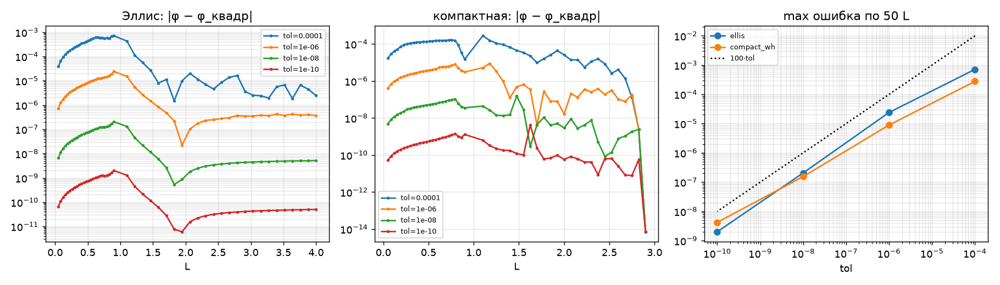
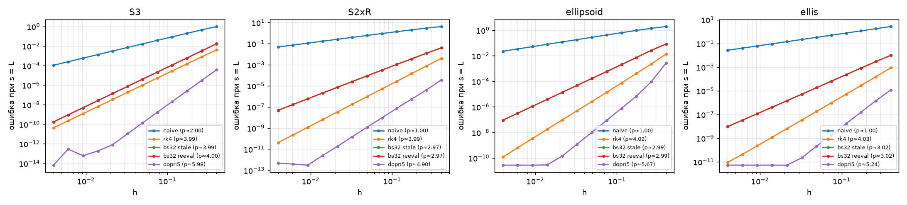
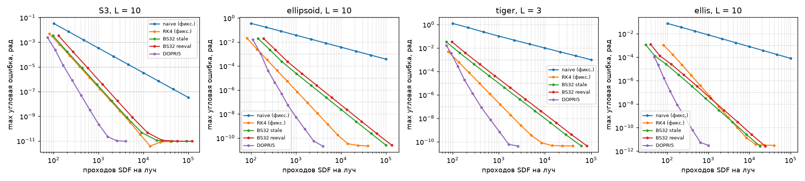
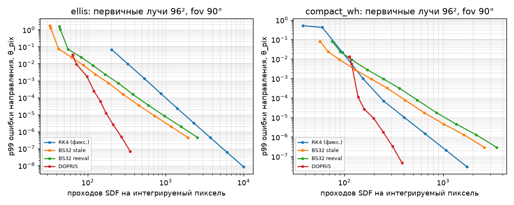
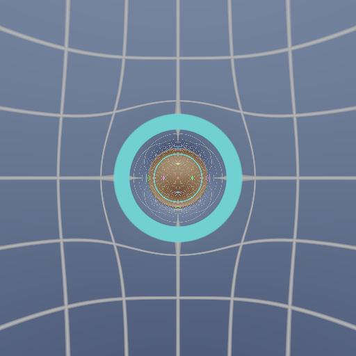
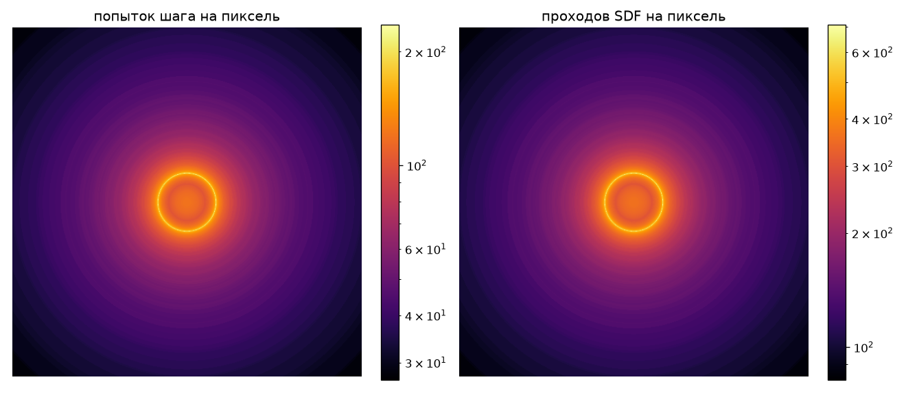
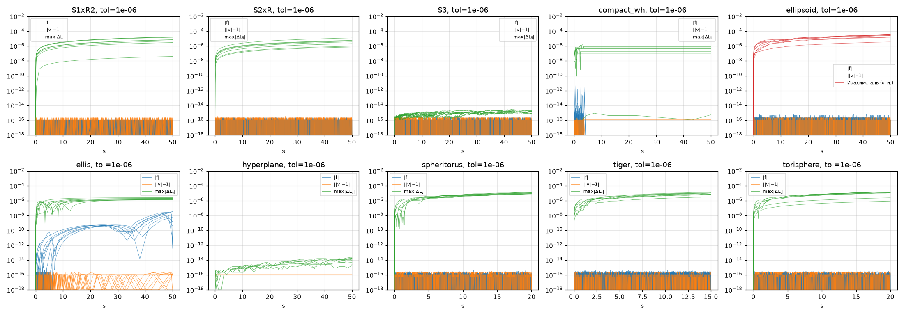

# Отчёт: этап 1 — прототип Python + JAX

Дата: 2026-10-23. Код: коммит `b2829e6` (все каталоги результатов ниже сняты с него, `git_dirty: false`).
Платформа: Windows 11, JAX 0.12 на CPU, float64 (meta.json в каждом каталоге).

## Критерии приёмки

| Критерий | Результат | Где |
|---|---|---|
| U1: jet против `jax.grad`/`jax.hessian` в 1000 точках, все фигуры + 2 червоточины | пройден, отн. ошибка < 1e-10 (Jet7 и полный гессиан Jet15) | `tests/test_u1_jet.py` |
| U2: BS32 против DOP853 (rtol 1e-12) и точных решений M13 | пройден, < 1e-6 при tol 1e-10 | `tests/test_u2_reference.py` |
| U3: |v| = 1, f = 0, моменты, Иоахимсталь + графики дрейфа | пройден; графики — `invariant_drift/drift.png` | `tests/test_u3_invariants.py` |
| U4: обратимость | пройден, < 1e-6 | `tests/test_u4_reversibility.py` |
| U5: f → f + f³, f·eᶠ, f·(1 + ½\|p\|²) | пройден, < 1e-6 | `tests/test_u5_u6_invariance.py` |
| U6: SO(4) + сдвиг: траектории и картинка | пройден (траектории < 1e-6; картинка Эллиса 32²: направления < 0.05 θ_pix) | там же |
| Угол Эллиса против квадратуры, 50 L | пройден: max ошибка 2.1e-7 рад при tol 1e-8 (порог теста 1e-6) | `deflection/` |
| Наблюдаемый порядок ≈ 3 | пройден: BS32 2.97–3.02 (S²×R, эллипсоид, Эллис); 4.0 на S³ (суперсходимость из-за симметрии) | `convergence/` |
| Бенчмарк «вызовы SDF на луч при равной угловой точности» | выполнен; см. ниже — BS32 не всегда выигрывает | `benchmark/`, `render_benchmark/` |
| Картинка Эллиса 512² + тепловая карта шагов | выполнена | `ellis_render/` |

Каталоги — `results/stage-1/2026-10-23_*`.

## Угол отклонения

[`deflection/summary.json`](../../results/stage-1/2026-10-23_deflection/summary.json), 50 прицельных параметров
(L ∈ [0.05, 0.9] ∪ [1.1, 4]·b), полный угол φ от камеры до бесконечности с поправкой хвоста M10:

| tol | Эллис, max \|Δφ\| | компактная, max \|Δφ\| | Эллис, SDF/луч |
|---|---|---|---|
| 1e-4 | 7.1e-4 | 2.8e-4 | 137 |
| 1e-6 | 2.4e-5 | 8.9e-6 | 430 |
| 1e-8 | 2.1e-7 | 1.5e-7 | 1921 |
| 1e-10 | 2.0e-9 | 4.2e-9 | 8885 |

Лист выхода совпадает с квадратурой во всех случаях. Ошибка ∝ tol.

## Сходимость (фиксированный шаг)

Наблюдаемые порядки ([CSV](../../results/stage-1/2026-10-23_convergence/convergence.csv)): наивная схема 1
(2 на S³), RK4 ≈ 4, BS32 ≈ 3 (stale и reeval одинаково), DOPRI5 4.9–6.

## Бенчмарк 1: тестовые фигуры, длинный путь

[`benchmark/table.md`](../../results/stage-1/2026-10-23_benchmark/table.md): 32 случайных луча, путь
L = min(10, 10ℓ_s), ошибка — максимум угла между v(L) и эталоном. Проходов SDF на луч:

| ошибка ≤ | метод | S³ | эллипсоид | «тигр» | Эллис |
|---|---|---|---|---|---|
| 1e-3 | наивная (фикс.) | 579 | 37116 | 97715 | 7794 |
| | RK4 (фикс.) | 121 | 172 | 120 | 82 |
| | **BS32 stale** | 131 | 327 | 218 | **31** |
| | BS32 reeval | 175 | 436 | 290 | 41 |
| | DOPRI5 | **85** | **165** | **109** | 48 |
| 1e-5 | RK4 (фикс.) | 384 | 548 | 378 | 280 |
| | BS32 stale | 412 | 1352 | 989 | 128 |
| | DOPRI5 | **172** | **298** | **199** | **66** |
| 1e-7 | BS32 stale | 1289 | 6241 | 4568 | 586 |
| | DOPRI5 | **366** | **605** | **409** | **122** |

На длинных путях по сильно искривлённым компактным фигурам DOPRI5 дешевле BS32 в 1.5–10 раз.

## Бенчмарк 2: первичные лучи рендера (главный для выбора метода)

[`render_benchmark/table.md`](../../results/stage-1/2026-10-23_render_benchmark/table.md): 96², fov 90°,
ошибка выходного направления в θ_pix (p99 по пикселям), эталон DOPRI5 tol 1e-12. Проходов SDF на интегрируемый пиксель:

| p99 ≤ | метод | Эллис | компактная |
|---|---|---|---|
| 0.1 θ_pix | RK4 (фикс.) | 203 | 75 |
| | **BS32 stale** | **41** | **56** |
| | BS32 reeval | 54 | 75 |
| | DOPRI5 | 64 | 112 |
| 0.01 θ_pix | RK4 (фикс.) | 325 | 108 |
| | BS32 stale | 82 | **87** |
| | BS32 reeval | 109 | 115 |
| | DOPRI5 | **71** | 114 |

**Оговорка: ограничение шага.** При p99 ≤ 0.1 θ_pix оба адаптивных метода у компактной червоточины упираются
в `hcap` (b/4 внутри шара). У BS32 стоимость не меняется между tol 1e-2 и 2.3e-3 (56.4 и 56.6), у DOPRI5 —
112 на обоих порогах. Там сравниваются 3 и 6 проходов SDF на ограниченный шаг, а не эффективность схем.
Ограничение нужно для корректности (туннелирование), так что для этой сцены сравнение ограничено им
по конструкции. Для Эллиса проверено отдельно, без ограничения (`h_max = ∞`,
[`render_benchmark_ellis_nocap/table.md`](../../results/stage-1/2026-10-23_render_benchmark_ellis_nocap/table.md)):
при p99 ≤ 0.1 θ_pix BS32 stale 41, DOPRI5 60; при ≤ 0.01 θ_pix BS32 82, DOPRI5 73.

**Вывод.** На Эллисе, где ограничение шага не влияет, BS32 stale в 1.5 раза дешевле DOPRI5 при точности
0.1 θ_pix, а при 0.01 θ_pix методы почти равны. На компактной червоточине BS32 вдвое дешевле, но это следствие
ограничения шага (3 против 6 вызовов на шаг), а не порядка схемы. Выбор BS32 для первичных лучей с точностью
уровня пикселя подтверждён. DOPRI5
выигрывает только при точности ≪ θ_pix и на длинных путях по компактным фигурам (кандидат для эталонов и,
возможно, для длинных вторичных лучей режима B). Предложение: оставить BS32 рабочим методом, DOPRI5 держать как опцию (решение — за пользователем,
см. PROGRESS). Вариант FSAL «stale» дешевле «reeval» на 25–35 % при той же точности — принят по умолчанию.

## Рендер Эллиса 512²

[`ellis_render/stats.json`](../../results/stage-1/2026-10-23_ellis_render/stats.json): камера на ℓ = 6b,
fov 90°, tol = 1e-3·θ_pix (ADR-0002), выход при |ℓ| = 20b с аналитической поправкой хвоста M10.
3.96 с на CPU; в среднем 47.6 попытки шага и 144 прохода SDF на пиксель (медиана 124, p99 394, максимум 236
попыток у фотонного кольца); ни один луч не упёрся в потолок шагов.

Голубое кольцо — полюс −x верхнего листа (точно за червоточиной), растянутый в кольцо Эйнштейна. В горловине
виден тёплый нижний лист. У фотонной сферы — мелкие кольца с алиасингом (без AA; это задача этапа 2).

## Дрейф инвариантов (U3)

[`invariant_drift/summary.json`](../../results/stage-1/2026-10-23_invariant_drift/summary.json), tol 1e-6,
путь 50ℓ_s: ||v| − 1| ≤ 3e-16 везде; |f| ≤ 7e-16 на компактных фигурах. У Эллиса |f| ≤ 3.4e-8: это квадратичный
остаток одного шага Ньютона при больших шагах в асимптотике (ρ ≈ 50), он не накапливается. Моменты дрейфуют
≤ 2e-5, Иоахимсталь ≤ 3.5e-5 (отн.), рост медленный, ∝ tol.

## Отклонения от плана и их причины

- **α = 0.1/ℓ_s вместо ~1/ℓ_s** (ADR-0001): с проекцией после шага α = 1/ℓ_s ухудшает точность в 2–7 раз,
  α = 10/ℓ_s нестабильно.
- **Ограничение шага `Shape.hcap`**: в плоских зонах оценка ошибки ≡ 0, шаг «туннелировал» сквозь кривизну
  (ошибка до 2e-2 рад, не зависящая от tol). Решение — sphere tracing до носителя кривизны (DD-001).
- **Допуск tol = 1e-3·θ_pix** подобран по измерению (ADR-0002).

## Переносится в этап 2

- Поля Якоби на Jet15 (гессиан уже проверен U1), тест U7.
- Тесты картинкой S³ и S¹×R² (нужны светящиеся маркеры и рендер компактных фигур).
- Решение пользователя по методу (BS32 vs DOPRI5 как опция).
- Проверить перенос κ на другие разрешения.
