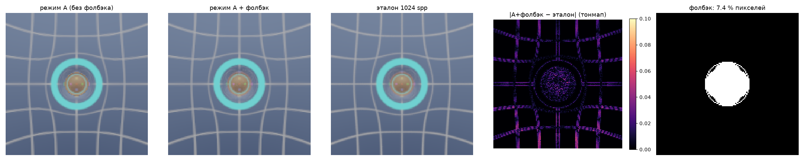
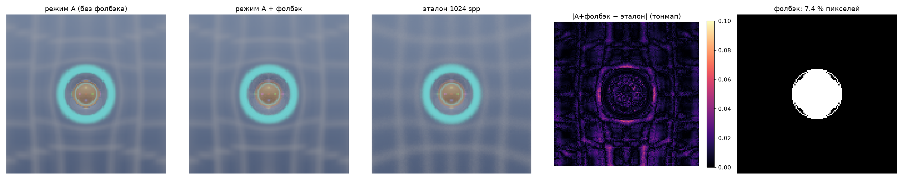
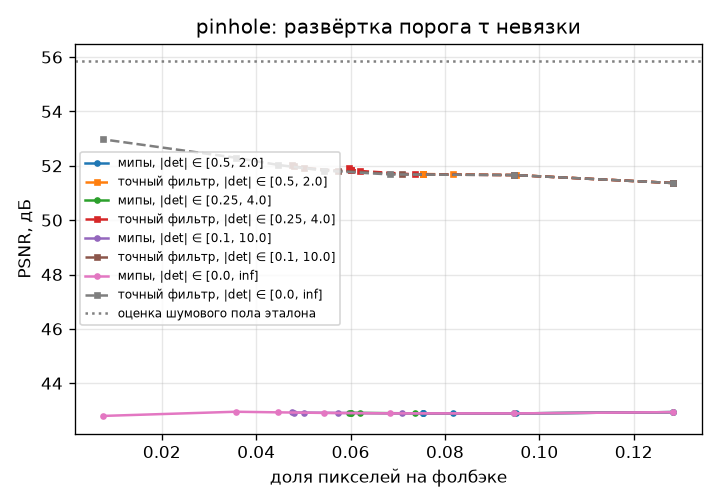
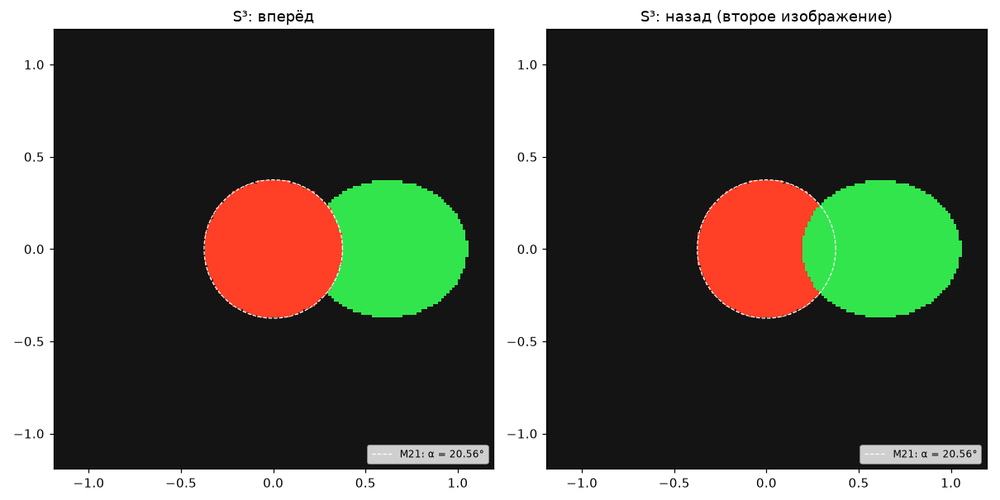
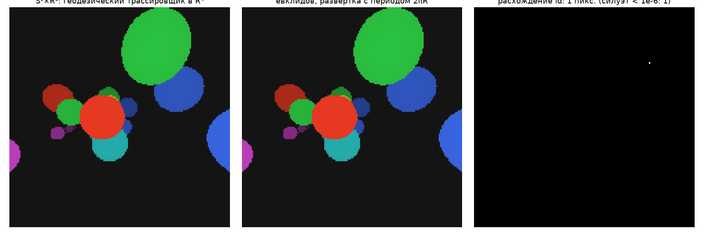

# Отчёт: этап 2 — режим A (AA + глубина резкости через матрицу Якоби)

Дата: 2026-10-24. Код результатов: коммиты `440f22d` (transfer_accuracy, picture_tests) и `ea511e7`
(modea_vs_reference, footprint_check); везде `git_dirty: false`. Платформа: Windows 11, JAX 0.12 CPU, float64.
Каталоги: `results/stage-2/2026-10-24_*`.

## Критерии приёмки

| Критерий | Результат | Где |
|---|---|---|
| U7 до рендера | пройден: поля против вариации точных решений (S³, S²×R, S¹×R², гиперплоскость) < 1e-7; K из полей против аналитической < 1e-3; S²×R — анизотропия cos²β/R² и 0; S¹×R²: K ≡ 0 | `tests/test_u7_jacobi.py` |
| Матрица переноса против разностей, все фигуры, < 1e-4 | пройден: max 3.5e-5 («тигр»), остальные ≤ 1.1e-6 при tol 1e-10; + варианты U5 с \|∇f\| ≠ 1; производная направления выхода обеих червоточин, включая почти радиальный луч | `tests/test_transfer_matrix.py`, `transfer_accuracy/` |
| Тест картинкой S³ | пройден: угловой радиус бисекцией совпадает с sin α = sin(a/R)/sin(d/R) до 1e-6 спереди и сзади; длины путей d − a и 2πR − d − a; при d → πR маркер во всех направлениях | `tests/test_picture_s3.py`, `picture_tests/` |
| Тест картинкой S¹×R² попиксельно | пройден: id попаданий совпадают на всех несилуэтных пикселях; расстояния до попадания < 1e-6 (tol 1e-10) | `tests/test_picture_s1r2.py`, `picture_tests/` |
| Режим A против эталона 1024 spp, PSNR, доля фолбэка | выполнено, см. ниже | `modea_vs_reference/`, `footprint_check/` |

## Точность матрицы переноса

[`transfer_accuracy/table.md`](../../results/stage-2/2026-10-24_transfer_accuracy/table.md): 6 камер на фигуру,
путь min(10, 10ℓ_s), соседи — DOPRI5 tol 1e-13. Ошибка столбца нормирована на полную норму (∂x, ∂v).

| фигура | tol 1e-10 | tol = 1e-3·θ_pix | Jet7 / скаляр | Jet15 / скаляр |
|---|---|---|---|---|
| S¹×R² | 1.4e-8 | 2.3e-4 | 1.1 | 18.8 |
| S²×R | 1.9e-8 | 2.5e-4 | 1.1 | 23.7 |
| S³ | 4.2e-9 | 2.3e-4 | 1.1 | 23.6 |
| компактная червоточина | 7.2e-9 | 8.2e-5 | 1.6 | 27.8 |
| эллипсоид | 1.3e-7 | 1.2e-3 | 1.3 | 19.0 |
| Эллис | 1.4e-8 | 7.4e-5 | 1.4 | 18.2 |
| сферитор | 1.1e-6 | 9.4e-4 | 1.4 | 26.9 |
| «тигр» | 3.5e-5 | 1.1e-3 | 1.8 | 26.0 |
| ториосфера | 2.2e-8 | 4.0e-4 | 1.7 | 19.4 |
| гиперплоскость | 7.7e-10 | 7.7e-10 | — | — |

Варианты U5 (`S3/mult`, `ellipsoid/mult`, `tiger/fexp`, `ellis/mult`) дают те же числа: множитель |∇f| в S
учтён верно. При фиксированном шаге расхождение полей и разностей сходится с порядком ≈ 3: M15 — линеаризация
только на M, а стадии RK чуть сходят с M (тест `test_consistency_fixed_steps`).

**Стоимость Jet15** — в 18–28 раз дороже скалярного SDF на CPU (Jet7 — в 1.1–1.8 раза). Это главная статья
расходов режима A и первый кандидат на оптимизацию на этапе 3: вместо полного гессиана нужны только
произведения H·v и H·J_k (направленные jet-числа).

## Режим A против эталона

Сцена — Эллис, камера на ℓ = 6, fov 90°, 128², кубмапа 512 на грань, tol = 1e-3·θ_pix. Эталон — 1024 spp
(две независимые половины по 512), те же распределения: гаусс пикселя σ = 0.5 px, гаусс апертуры. PSNR — по
тонмапленным [0, 1]. [`modea_vs_reference/summary.json`](../../results/stage-2/2026-10-24_modea_vs_reference/summary.json).

| | pinhole | DoF (σ_ap = 0.3, F = 6) |
|---|---|---|
| шумовой пол эталона (оценка: половины + 6 дБ) | 55.8 | 51.0 |
| **режим A, фильтр мипами, без фолбэка** | 41.7 | 40.2 |
| режим A, мипы + фолбэк (τ = 2, \|det\| ∈ [0.1, 10]; 4.8 %) | 42.9 | 41.0 |
| режим A, **точный гауссов фильтр**, без фолбэка | 46.9 | 45.8 |
| режим A, точный фильтр, только непомеченные пиксели | **57.2** | **50.8** |
| режим A, точный фильтр + фолбэк (τ = 2, \|det\| ∈ [0.1, 10]) | 52.0 | 49.1 |
| режим A, точный фильтр + фолбэк только по смене листа (0.76 %) | 53.0 | 49.6 |
| только стохастика 256 spp (фолбэк везде) | 48.9 | 44.0 |
| время, с (CPU): режим A / эталон | 5.7 / 136 | 5.0 / 138 |
| проходов Jet15 на пиксель (режим A) | 102 | 102 |

Против эталона с равномерным диском апертуры (256 spp) режим A даёт 37.7 дБ против 40.2 дБ при гауссовой:
ошибка формы боке ≈ 2.5 дБ — свойство гауссовой модели апертуры, а не Якоби.

### Разложение ошибки

1. **След Якоби верен.** Без текстуры: ковариация направлений выхода стохастических лучей пикселя против Σ (M18)
   ([`footprint_check/summary.json`](../../results/stage-2/2026-10-24_footprint_check/summary.json), 200 пикселей ×
   4096 лучей): медиана относительной ошибки 2.4 % (pinhole), 2.1 % (DoF σ_ap = 0.3), 2.4 % (DoF σ_ap = 0.05)
   при статистическом шуме оценки 2.2 %. Смещение среднего направления — 1.7–2.7 % σ (на уровне статистики).
   С точным гауссовым фильтром непомеченные пиксели достигают шумового пола эталона (57.2 / 50.8 дБ).
2. **Главная ошибка — фильтр мипами** (аппроксимация EWA по M19 с боксовыми мипами): −10…−14 дБ на непомеченных пикселях (57.2 → 43.0, 50.8 → 41.1), на тонких
   линиях сетки фона (0.5° ≈ 2 текселя). Это эмуляция аппаратной анизотропной выборки; на этапе 3 вместо неё будет
   `SampleGrad`, и качество нужно будет измерить заново. Пути улучшения: гауссово префильтрованные мипы вместо
   боксовых, больше отсчётов вдоль большой оси, выше разрешение кубмапы.
3. **Фолбэк.** Пиксели горловины со сменой листа у соседей (0.76 %) обязаны идти на фолбэк: +6 дБ
   (46.9 → 53.0). Критерии по невязке и |det| на этой сцене не окупаются: режим A там точнее, чем 256 spp фолбэка
   (развёртка: `pinhole_detector_sweep.png`, `dof_detector_sweep.png`).
   Первоначальные пороги τ = 0.25, |det| ∈ [0.25, 4] отправляли на фолбэк весь диск горловины (7.4 %).
   По развёртке пороги по умолчанию ослаблены до τ = 2, |det| ∈ [0.1, 10] (4.8 %). Каустик в фоне Эллиса
   нет, поэтому защитная роль этих критериев здесь не проверена.

## Тесты картинкой

S³: маркер радиуса 0.3 на расстоянии 1 — спереди и сзади одного размера (пунктир — M21, α = 20.56°). Порядок
перекрытия с боковым маркером сзади обратный, как и должно быть.

S¹×R² при рабочем tol (1e-3·θ_pix): 1 пиксель с другим id из 25 600, и он силуэтный (зазор < 1e-6).
Максимальная разница расстояний до попадания — 5.6e-3 у касательных попаданий
([`stats.json`](../../results/stage-2/2026-10-24_picture_tests/stats.json)). При tol 1e-10 в тесте — < 1e-6.

## Отклонения от плана и их причины

- **Фильтр кубмапы**: шаг отсчётов ≤ 2·размытия уровня при 16 отсчётах выбран измерением (не хуже 32 отсчётов
  с шагом ≤ 1·размытия). При анизотропии ≥ 8 и следах ≳ 0.3 рад малая ось перемывается, как при аппаратном
  зажиме анизотропии.
- **Бесшовная кубмапа**: грани с рамкой в 1 тексель. Без неё билинейная выборка у рёбер ошибалась до 0.018.
- **Эталонный фильтр** — плотная сетка с шагом ≤ 0.7 текселя. Квадратура Гаусса–Эрмита 8×8 на следах
  ≳ 5 текселей пропускала тонкие линии и давала ложный вывод «точный фильтр хуже мипов» для DoF.
- **Пороги детектора** ослаблены по развёртке (см. выше).
- **Критерий «вне каустик»** в тесте матрицы переноса убран: метрика нормирована на полную норму (∂x, ∂v),
  которая не обращается в ноль. Плоский критерий det/L² ошибочно исключал все камеры S³ из-за фокусировки.

## Переносится в этап 3

- Измерить качество аппаратной `SampleGrad` против точного фильтра; при необходимости — гауссовы мипы.
- Jet15 → направленные произведения H·v, H·J (основная стоимость режима A).
- Проверить детектор на сцене с каустиками в фоне (две червоточины).
- Производная выхода (`jax.jvp` функции выхода) — заменить ручной формулой для GPU.
