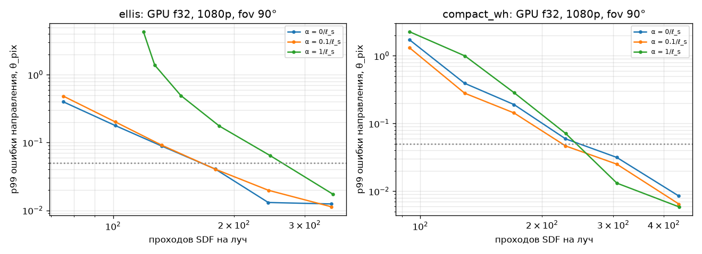

# Отчёт: этап 3 — порт на GPU

Дата: 2026-10-24. RTX 4080 SUPER (16 ГБ), драйвер 610.88, Vulkan 1.4.341, Slang 2025.17.2 (Vulkan SDK 1.4.328.1),
MSVC 14.44. Каталоги результатов — `results/stage-3/2026-10-24_*`, у всех `git_dirty: false`
(gpu_vs_prototype — `625ff99`, gpu_kappa_alpha — `37e9d6b`, gpu_profile — `647ed9c`, gpu_modea_quality — `08af093`).

## Критерии приёмки

| Критерий | Результат | Где |
|---|---|---|
| GPU прогоняет весь набор фигур и червоточин | пройден: 10 фигур + 2 червоточины в `trace`; U1 на GPU для 11 SDF (Jet7, HVP, Jet15) — отн. ошибка < 2e-5 | `gpu_vs_prototype/`, `tests/test_gpu_*.py` |
| Расхождение с прототипом на уровне float32, таблица по фигурам | пройден по критерию DD-004 п. 3 (определён до результатов): e_GPU / e_прототип-f32 ≤ 4. Получено 0.74–1.42 (лучи), 0.82–1.34 (поля Якоби); гиперплоскость 1.34 / 1.80 при абсолютной ошибке ≤ 2e-6 | `gpu_vs_prototype/table.md` |
| Профилирование: мс на кадр 1080p и 4K, шагов на луч, занятость | выполнено (timestamps, медиана 5 прогонов; регистры — VK_KHR_pipeline_executable_properties; занятость — расчёт) | `gpu_profile/` |
| Режим A 1080p — 20–60 мс | **40.0 мс** (Эллис), **31.2 мс** (компактная червоточина), wavefront K = 32, Jet15 | `gpu_profile/table.md` |

Дополнительно DD-004 требовал второе сравнение — e_GPU против e_прототип-f64 при том же tol. При tol 1e-5 ошибка
усечения доминирует, и все три варианта совпадают (отношение ≈ 1). При tol 1e-6 видно округление float32:
S³ — 8.3e-6 против 3.7e-6, компактная — 1.5e-4 против 6.4e-5, гиперплоскость — 2.3e-6 против 3.4e-7. Прототип-f32
даёт то же (5.8e-6, 1.1e-4, 1.7e-6), так что это свойство float32, а не порта.

## Архитектура (кратко, подробно — DD-004)

- Slang → SPIR-V → Vulkan compute; хост C++20 (volk, VMA). SDF пишутся один раз (`IReal` + перегруженные
  операторы) и работают на Real, Jet7, JetHVP, Jet15, Dual4.
- Хост: исполнитель одиночных диспетчеризаций (`run`) и графов (`graph`: именованные буферы, прямые и косвенные
  диспетчеризации, циклы, метки времени) — стенд для сравнения с прототипом через `.npy`.
- Режим A wavefront: init (пиксель → луч + поля M16, пролёт M25) → итерации {args → integrate K шагов, компакция в
  очередь} → finish (∂v M17, d∞ и ∂d∞ дуальными числами M24) → оттенение (SampleGrad) → детектор (M20) →
  очередь фолбэка → фолбэк порциями по 8 сэмплов (косвенно) → редукция. Весь кадр — один командный буфер.
- Кубмапы: cube array (2 листа), мипы blit (бокс 2×2), BC6H — GPURealTimeBC6H (MIT, vendored) на GPU.

## Точность float32: κ и α (ADR-0004)

[`gpu_kappa_alpha/table.md`](../../results/stage-3/2026-10-24_gpu_kappa_alpha/table.md): правило DD-004 п. 2
даёт **κ = 3e-3** (p99 0.040 / 0.047 θ_pix на Эллисе / компактной при 180 / 229 проходах) и подтверждает
**α = 0.1/ℓ_s**. Пол округления float32 при 1080p не достигнут (κ = 3e-4 → p99 0.011 / 0.0065 θ_pix).

## Качество режима A на GPU (ADR-0005)

[`gpu_modea_quality/table.md`](../../results/stage-3/2026-10-24_gpu_modea_quality/table.md), Эллис 128², против эталона
1024 spp этапа 2:

| | pinhole | DoF |
|---|---|---|
| GPU, SampleGrad k = 2, RGBA16F / BC6H, без фолбэка | 39.0 / 38.8 | 36.9 / 36.4 |
| GPU, + фолбэк (детектор по умолчанию, 4.8 %, 256 spp), RGBA16F / BC6H | 41.2 / 41.0 | 38.0 / 37.4 |
| GPU, программный M19, RGBA16F, без фолбэка | 40.3 | 37.2 |
| прототип, M19 с боксовыми мипами / точный гауссов фильтр, без фолбэка | 41.7 / 46.9 | 40.2 / 45.8 |
| шумовой пол эталона | 55.8 | 51.0 |

- Калибровка k для SampleGrad: максимум при k = 2 на обеих конфигурациях (k = 1.5 и 2.5 хуже на 0.6–1.3 дБ).
- BC6H стоит 0.2–0.5 дБ.
- Аппаратная анизотропная выборка уступает программному M19 1.3 дБ (pinhole) и 0.3 дБ (DoF) без фолбэка;
  M19 стоит +0.04 мс в 1080p. По умолчанию оставлен SampleGrad, M19 — опция.
- В отличие от прототипа, на GPU детектор по умолчанию окупается: +1–2 дБ против «только смены листа» (у горловины
  аппаратный фильтр слабее, и фолбэк там помогает). Пороги этапа 2 оставлены.
- Геометрия режима A на GPU (лучи и поля Якоби) проверена против прототипа в `tests/test_gpu_trace.py`
  (критерий ≤ 4× ошибки прототипа), wavefront против мегаядра — `test_wavefront_matches_megakernel`.

## Профиль (DD-004 п. 9)

[`gpu_profile/table.md`](../../results/stage-3/2026-10-24_gpu_profile/table.md), κ = 3e-3, BC6H, фолбэк 64 spp,
медиана 5 прогонов. Время, мс:

| разрешение | сцена | вариант | интегрирование | init+finish | оттенение+детектор | фолбэк | **всего** | фолбэк, % пикс. |
|---|---|---|---|---|---|---|---|---|
| 1080p | Эллис | мегаядро | 10.59 | — | 0.45 | 43.65 | **54.7** | 8.6 |
| 1080p | Эллис | wavefront K=32, Jet15 | 10.81 | 1.40 | 0.51 | 27.29 | **40.0** | 8.6 |
| 1080p | Эллис | wavefront K=16, HVP | 10.83 | 1.38 | 0.50 | 28.00 | **40.7** | 8.6 |
| 1080p | компактная | мегаядро | 4.51 | — | 0.44 | 32.67 | **37.6** | 5.3 |
| 1080p | компактная | wavefront K=32, Jet15 | 3.98 | 1.36 | 0.50 | 25.39 | **31.2** | 5.3 |
| 4K | Эллис | wavefront K=32, Jet15 | 51.78 | 5.47 | 2.12 | 130.00 | **189.4** | 8.6 |
| 4K | компактная | wavefront K=32, Jet15 | 17.73 | 5.99 | 1.91 | 118.54 | **144.2** | 5.3 |

- Проходов Jet15 на центральный луч: в среднем 181 (Эллис), 51 (компактная: часть пикселей мимо шара); распределение —
  `passes_hist.png`.
- Регистры (драйвер): интегрирование с Якоби — 252 (Jet15) / 245 (HVP), занятость 17 % (8 варпов на SM);
  конвейер «только луч» — 29–69 регистров. HVP не уменьшает ни регистры, ни время.
- K: от 8 к 32 интегрирование ускоряется с 13.0 до 10.8 мс (меньше перезапусков FSAL и барьеров); 64 — не лучше.
- Wavefront против мегаядра: интегрирование одинаково (длины лучей распределены компактно, 100–600 проходов;
  предел — занятость). Выигрыш — во фолбэке порциями (43.7 → 27.3 мс).

**Узкое место.** В 1080p — фолбэк (68 % кадра Эллиса), затем интегрирование с занятостью 17 % из-за 252 регистров.
В 4K всё масштабируется ×4.7. Пути ускорения, в порядке ожидаемого эффекта: (1) фолбэк — меньше пикселей
(детектор) или меньше сэмплов; (2) регистры канала Якоби — разбиение 2×2 или хранение E в shared memory;
(3) профиль Nsight Graphics (ждёт установки пользователем).

## Отклонения от плана и их причины

- **HVP-jet** реализован и проверен (U1, Якоби против Jet15), но не дал выигрыша ни в регистрах, ни во времени —
  оставлен опцией, по умолчанию Jet15.
- **Wavefront** не ускорил интегрирование (только фолбэк); мегаядро сохранено как вариант для сравнения.
- **Фолбэк порциями** вместо «поток на пиксель» — после замера (11.5 → 0.7 мс на 128²).
- **Число итераций wavefront** берётся из калибровочного прогона (+2), иначе ~250 пустых диспетчеризаций стоили
  ~1.4 мс на 128²; проверяется, что усечение не меняет результат.
- **Ошибки по ходу:** `repr(np.float64)` в push-константах ломал разбор на хосте (теперь хост падает громко);
  буфер косвенных аргументов был мал (фолбэк не записывался) — найдено по PSNR.

## Переносится в этап 4

- Конвейер «только луч» (29–69 регистров) — основа path tracing.
- Граф задач хоста — для очередей режима B.
- Открытые: регистры канала Якоби (17 % занятости), фолбэк — главная статья в кадре, Nsight Graphics.
