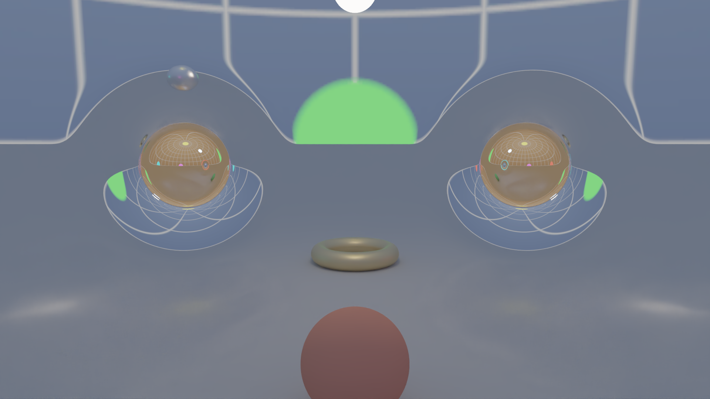

# Отчёт: этап 4 — режим B (трассировка путей)

Дата: 2026-10-24. RTX 4080 SUPER, драйвер 610.88, Slang 2025.17.2, OptiX 9.1 (заголовки optix-dev, библиотека драйвера).
Результаты: `results/stage-4/2026-10-24_gpu_pt_quality` (коммит `e6d05ef`) и `…_gpu_pt_profile` (`d6bcb9e`),
оба `git_dirty: false`. Дизайн — DD-005 (Accepted), решения — ADR-0006, ADR-0007, формулы M26–M32.

## Критерии приёмки

| Критерий (TASK.md, этап 4) | Результат | Где |
|---|---|---|
| Объекты — 4D SDF ∩ M; шаг ≤ g; уточнение эрмитовым сплайном | сделано (M26, M27): точка и направление попадания против DOP853 с событием — (1–9)·tol на гиперплоскости, S³, эллипсоиде, Эллисе (сквозь горловину), M11 (шар в зоне кривизны, тор на другом листе) | `tests/test_objects.py` |
| BSDF-сэмплирование, русская рулетка | Ламберт, GGX-металл (VNDF), рулетка с глубины 3; E[f·cos/pdf] = ∫f·cos | `test_pathtrace.py::test_bsdf_sampling_consistent` |
| NEE + MIS только при прямом соединении в той же плоской зоне | сделано (M29): сферические источники и фон (решение ревью) из плоских зон по отрезкам мимо шаров кривизны, на том же листе; веса MIS согласованы с этой областью. Проверено печью, аналитикой «пол + сферический источник» (MIS, только NEE, только BSDF — все совпадают), MIS против «только NEE» на сцене 3, независимым евклидовым трассировщиком | `test_pathtrace.py`, `test_gpu_pt.py` |
| Допуск интегратора растёт с глубиной | сделано (M30): tol = κ·max(θ_pix, γ); k_cone = 0.25 — −16 % проходов, −6 % времени сэмпла, смещения нет | ADR-0006, `gpu_pt_quality/table.md` |
| Ray cones для мип-уровня | **заменено по измерению**: мип по конусу даёт смещение +0.14…+0.40 % при снижении дисперсии < 1 %; фон во вторичных лучах — мип 0 | ADR-0006 |
| Пиксели с первичным лучом в фон — режим A без шума | сделано: проход камеры классифицирует пиксели (фон / объект / смешанный — объект в следе пикселя по полям Якоби); фон — режим A, фолбэк детектора — трассировщиком; PSNR фона против трассировки 4096 spp — 43.7 дБ при шумовом поле эталона 43.3 | `gpu_pt_quality/table.md` |
| Временное накопление при неподвижной камере | сделано: буферы накопления живут между диспетчеризациями (сэмпл за диспетчеризацию), проход камеры — один на позу | `gpu_pt.render*` |
| Денойзер (OptiX) с AOV альбедо и нормали | сделано (ADR-0007): OptiX HDR, AOV — альбедо и нормаль первого попадания в базисе камеры, перенесённом проекцией (M32). 1 spp: 22.4 → 36.8 дБ, 64 spp: 30.6 → 43.4 дБ | `gpu_pt_quality/table.md` |
| 1080p: 1 spp + денойзер — 40–100 мс | **51.4 мс** (сцена 3), 29.2 мс (Эллис) | `gpu_pt_profile/table.md` |
| 1080p: 64 spp + денойзер — 3–5 с | **0.39 с** (сцена 3), 0.13 с (Эллис) | там же |

## Профиль (1 командный буфер на кадр, медиана прогонов после прогрева; денойзер — отдельно)

[`gpu_pt_profile/table.md`](../../results/stage-4/2026-10-24_gpu_pt_profile/table.md), мс:

| сцена | разрешение | режим | камера | трассировщик | фолбэк | денойзер | **всего** |
|---|---|---|---|---|---|---|---|
| сцена 3 | 1080p | 1 spp, фолбэк 8 | 22.6 | 8.2 | 13.3 | 6.9 | **51.4** |
| сцена 3 | 1080p | 64 spp, фолбэк 64 | 13.7 | 310.2 | 60.9 | 7.5 | **392.8** |
| сцена 3 | 4K | 1 spp, фолбэк 8 | 53.0 | 20.2 | 33.3 | 27.1 | **135.1** |
| сцена 3 | 4K | 64 spp, фолбэк 64 | 54.0 | 1311.3 | 270.0 | 26.8 | **1663.5** |
| Эллис | 1080p | 1 spp, фолбэк 8 | 12.2 | 0.6 | 8.4 | 7.5 | **29.2** |
| Эллис | 1080p | 64 spp, фолбэк 64 | 12.5 | 37.3 | 68.3 | 6.9 | **125.7** |

Оттенение, детектор и построение списков — < 2 мс во всех случаях. Сцена 3: 35 % пикселей — фон (режим A), 64 % —
объекты, 0.7 % — смешанные, 6 % — фолбэк; 107 проходов Jet7 на путь. Регистры: трассировщик 96 (расчётная занятость 44 %; у Эллиса 80 — 52 %),
проход камеры с Якоби 247 (17 %, как на этапе 3).

- Проход камеры в «интерактиве» 22.6 мс против 13.7 мс в «финале» при одинаковой работе: короткий граф не разгоняет
  частоты GPU (12 прогонов подряд). В непрерывном цикле ожидается ближе к 14 мс — проверить на этапе 5.
- Время денойзера — только вычисления OptiX; пересылки хост ↔ GPU стенда не входят (обмен памятью Vulkan ↔ CUDA не сделан).
- Узкие места: в интерактиве — проход камеры с Якоби (занятость 17 %) и фолбэк; в финале — трассировщик.

## Качество ([`gpu_pt_quality/table.md`](../../results/stage-4/2026-10-24_gpu_pt_quality/table.md))

Сцена 3, 480×270, эталон — трассировщик 4096 spp (tol 1e-4), шумовой пол 43.3 дБ.

| spp | шумный | денойз: цвет | + альбедо | + альбедо + нормаль |
|---|---|---|---|---|
| 1 | 22.4 | 36.8 | 36.6 | 36.6 |
| 16 | 28.6 | 41.1 | 41.5 | 41.5 |
| 64 | 30.6 | 43.3 | 43.3 | 43.4 |

AOV на этой сцене почти не помогают (±0.4 дБ): мало текстур, гладкие материалы.

**Выдаваемый кадр** (граф: фон — режим A, остальное — трассировщик → денойзер → пиксели фона режима A восстановлены):

| spp / фолбэк | шумный кадр | выдаваемый кадр | полоса ±2 px у границ «режим A / трассировщик»: шумный / выдаваемый | трассированные вне полосы |
|---|---|---|---|---|
| 1 / 8 | 22.7 | **36.0** | 24.9 / 34.3 | 34.8 |
| 64 / 64 | 30.6 | **42.6** | 35.7 / 38.4 | 42.0 |

Полоса — 5.9 % пикселей. При 64 spp она на ≈ 4 дБ хуже внутренних областей: шов между точным фоном и
денойзенными пикселями (риск DD-005 п. 5 подтверждён). Кандидаты: смешивание по ширине следа у границы,
денойзер с маской классов.

## Отклонения от плана и найденные ошибки

- **Попадание по ε_hit вместо смены знака** (первая версия GPU): близкие промахи (0 < g < ε_hit) объявлялись
  попаданиями, точка оказывалась за объектом — печь показала −8 % энергии у силуэтов. Теперь попадание — только
  смена знака g; то же в теневом тесте (M26).
- **Смещение от поверхности ~ε_hit** уводило точку за соседнюю поверхность в щели «шар на полу» → обрывы путей.
  Теперь смещение — от пола округления.
- **Пологие лучи к бесконечному полу** обрывались по s_max (sphere tracing к плоскости сходится медленно) —
  полупространства на прямой пересекаются аналитически. **Разные допуски радиуса шара** в проверках прямой и
  в выходе интегратора отправляли лучи «в никуда». **1 − cos θ_max** далёкого источника во float32 = 0 → NaN.
  Все пять найдены печью и аналитическими тестами; после исправлений печь на GPU: 1.0002 / 1.0005 / 1.0000
  (сцена 3 / гиперплоскость / Эллис) при 8192 spp, обрывов нет.
- **M32**: базис AOV переносится проекцией на каждом шаге вместо HVP-прохода (то же к первому порядку, без Hv).
- **Фолбэк режима A** делает ядро трассировщика по списку: штатный фолбэк знает один шар кривизны, а трассировщик —
  объекты и обе червоточины.
- **Мегаядро + списки пикселей** вместо wavefront по отскокам: ориентиры выполнены, wavefront по отскокам не делался.
- **Мипы по конусу отключены** (ADR-0006), **OptiX без CUDA Toolkit** (ADR-0007).
- Диэлектрики отложены (решение ревью).

## Пункты плана проверки DD-005, не выполненные отдельно

- **п. 4 (M32 против точного переноса / аналитики S³)** — не сделан: перенос базиса нужен только для AOV-нормали,
  а AOV меняют качество денойзера на ±0.4 дБ; ошибка схемы проекции первого порядка на результат не влияет.
- **п. 6 (U1 для g, ∇g объектов на GPU)** — не отдельно: объекты вычисляются той же обобщённой арифметикой
  (Real, Dual4), что и SDF многообразий, проверенные U1 на GPU на этапе 3; попадания проверены сквозным образом.
- **п. 7 (точки попадания GPU против прототипа-f32, критерий ≤ 4×)** — не отдельно: покрыто сравнением кадров
  GPU против прототипа-f64 на трёх сценах (`test_gpu_vs_prototype`) и печью на GPU без обрывов.
- **п. 9, частично (развёртки c_hit и ε_off, тест утечек в замкнутой коробке)** — не сделаны: в наборе нет тонкой
  замкнутой геометрии; самопересечения после смещения видны в печи как попадания с обратной стороны — их 0.
  c_hit = 0.05 и ε_off = max(1e-4 ℓ_s, 4 ulp) не подбирались.

## Переносится в этап 5

- Обмен памятью Vulkan ↔ CUDA для денойзера (сейчас — копии через хост), один цикл кадра без процесса на кадр.
- Проход камеры: занятость 17 % (регистры канала Якоби) — главная статья интерактивного кадра вместе с фолбэком.
- Шов у границ «режим A / трассировщик»: −4 дБ в полосе ±2 px при 64 spp.
- Искры на полу у червоточин: источник виден там только сквозь кривизну, NEE запрещена правилом — шум убирает
  денойзер/накопление.
